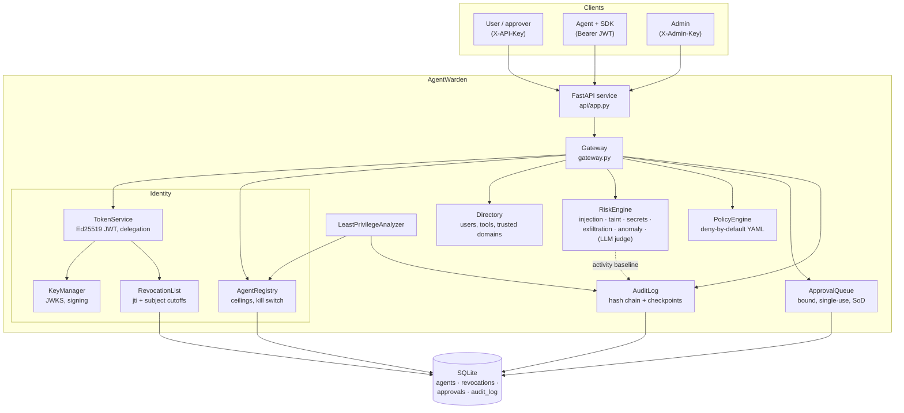
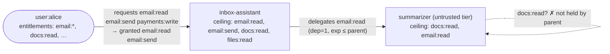
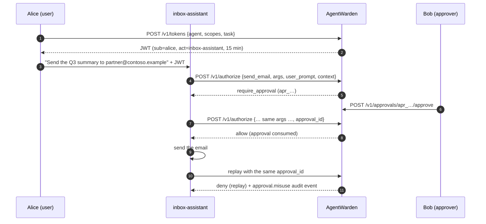

# Architecture

AgentWarden is a **policy enforcement point (PEP)** and **policy decision point (PDP)** for AI
agent tool calls. Agents call it *before* executing a tool. It answers `allow`, `deny` or
`require_approval`, with reasons and evidence, and records everything in a tamper-evident log.

## Components



| Module | Responsibility |
|---|---|
| `identity/keys.py` | Ed25519 key pair, RFC 7638 `kid`, JWKS, 0600 key files |
| `identity/scopes.py` | Scope syntax, wildcard ceilings, attenuation (`requested ∩ entitlements ∩ ceiling`) |
| `identity/tokens.py` | Issue, delegate and verify agent tokens (RFC 8693 `act` chains) |
| `identity/registry.py` | Agent registry and revocation list |
| `directory.py` | Users (roles, entitlements, API-key hashes), tools (scope, risk, side effect), trusted domains |
| `risk/text.py` | Normalization and de-obfuscation, entity extraction, derived call *facts* |
| `risk/detectors.py` | Heuristic detectors (one class each) |
| `risk/llm_judge.py` | Optional Claude classifier for untrusted content |
| `risk/engine.py` | Signal aggregation and scoring |
| `policy/` | Schema, evaluator, policy-as-code test runner |
| `approvals.py` | Human-in-the-loop queue |
| `audit.py` | Append-only hash chain, verification, signed checkpoints, activity queries |
| `analyzer.py` | Least-privilege findings from audit history |
| `gateway.py` | The decision pipeline that wires everything together |
| `api/`, `sdk/`, `cli.py` | HTTP API, Python SDK, command line |

## Identity model

| Principal | Represented as | Authenticates with |
|---|---|---|
| Human user | `User` in the directory (roles, entitlements) | API key hash (demo stand-in for OIDC, v0.2) |
| Agent | `Agent` in the registry (owner, trust tier, scope ceiling, enabled) | Delegated JWT |
| Admin | n/a | `X-Admin-Key` shared secret (constant-time compare) |

### Agent tokens

```json
{
  "iss": "https://agentwarden.local",
  "aud": "agentwarden",
  "sub": "user:alice",
  "act": { "sub": "agent:summarizer", "act": { "sub": "agent:inbox-assistant" } },
  "scope": "email:read",
  "roles": ["employee", "finance"],
  "task": "triage inbox",
  "dep": 1,
  "anc": ["<parent jti>"],
  "iat": 1793521833.004,
  "exp": 1793522733.004,
  "jti": "a55ac56cea964b608d4f9944e6b57282"
}
```

- `sub` is always the **human**, and `act` is the chain of **agents** acting for them (outermost =
  current actor). This is the RFC 8693 delegation layout.
- Header: `{"alg": "EdDSA", "kid": "<RFC 7638 thumbprint>", "typ": "at+jwt"}`. Verification
  rejects any other `alg` *before* touching the key, and rejects unknown `kid`s.
- **Granted scopes** = requested ∩ user entitlements ∩ agent ceiling. Requested scopes must be
  concrete; wildcards (`files:*`) are only allowed in ceilings and entitlements.
- **Delegation** requires `scopes ⊆ parent.scopes`, so an escalation attempt is an error and is
  audited. The result is further intersected with the sub-agent's ceiling. `exp` is clamped to the
  parent's, `dep ≤ max_delegation_depth`, and cycles are rejected.
- **Revocation**: by `jti`, by ancestor (`anc`, so revoking a parent kills all children), and by
  subject (`user:x` / `agent:y` tokens issued at or before a cutoff). Disabling an agent also
  subject-revokes it, so re-enabling never resurrects leaked tokens.



## The decision pipeline

`Gateway.authorize(token, request)`, where `request = {tool, args, user_prompt, context[], approval_id?}`:

1. **Authenticate**: signature, `iss`/`aud`/`exp`/`iat`, structural consistency (`dep` vs. `act`
   depth, ancestors) and revocation. Failures raise 401 and are audited as `auth.failed`.
2. **Continuous authorization**. All of these are deterministic denies:
   - every agent in the actor chain is registered and enabled (kill switch);
   - the user still exists;
   - the tool is known (unknown tools are denied);
   - the token carries the tool's scope, *and* the scope is still in the agent's **current** ceiling
     and the user's **current** entitlements (revoking an entitlement takes effect immediately).
3. **Facts**: derived from the arguments: recipients and external recipients (by trusted
   domain), URLs, domains and external domains, normalized file path (percent-decoding,
   backslashes, `..`), argument size, and whether untrusted context is present.
4. **Risk**: detectors produce signals with weights and evidence (see below).
5. **Policy**: the evaluation context (identity, delegation depth, tool, args, facts, risk, token task,
   time) goes into the policy engine. Combining algorithm: `deny` > no `allow` (default deny) >
   `require_approval` > `allow`.
6. **Approval**: for `require_approval`, a presented `approval_id` is checked against a binding
   hash of `(user, actor chain, tool, args)`. Possible outcomes: *consumed* (→ allow), *pending*,
   *denied* (→ deny), *mismatch* or *used* (→ deny + `approval.misuse` audit event), or
   *expired/unknown* (→ a new approval is requested).
7. **Audit**: one `authz.decision` entry with decision, reasons, matched rules, risk summary,
   redacted argument preview, argument hash, facts and context sources.



## Risk scoring

Each detector returns signals with weights in `[0, 1]`, scaled by how dangerous the tool's
**sink** is (`none/read` ×0.5, `write` ×0.8, `external` ×1.0 for injection signals).

| Detector | Signals (weight at an external sink) | Evidence |
|---|---|---|
| `injection` | `instruction_override` 0.6, `role_hijack` 0.45, `system_prompt_probe` 0.35, `agent_addressing` 0.4, `concealment` 0.5, `markdown_exfil` 0.5, `hidden_html` 0.3, `action_directive` 0.2, `unicode_tag_smuggling` 0.7, `bidi_control_characters` 0.4, `zero_width_obfuscation` 0.35, `encoded_instructions` ≥0.5, `injection_in_arguments` 0.7×pattern | Matched snippet of the *normalized* text and its source segment |
| `taint` | `tainted_external_destination` 0.7, `tainted_internal_destination` 0.15, `tainted_path` 0.3 | The destination and the untrusted segment it came from |
| `secrets` | `secret_in_arguments` 0.8 external / 0.4 write / 0.2 read | Kind and redacted preview |
| `exfiltration` | `external_recipient` 0.25, `bulk_recipients` 0.3, `external_destination` 0.1, `data_in_url` 0.45, `encoded_payload` 0.3, `large_payload` 0.15 | Recipients, hosts, sizes |
| `anomaly` | `high_velocity` 0.35, `repeated_denials` 0.3, `novel_sensitive_tool` 0.15 | Counts from the audit log |
| `llm_judge` | `llm_injection_verdict` 0.8×confidence | Model rationale |

**Aggregation.**

1. Keep the strongest signal per name.
2. Within one detector, the strongest signal counts fully and corroborating signals count at 50%,
   since they're correlated: `d = 1 − (1−w₁)·Π(1−0.5·wᵢ)`.
3. **Context-only cap**: when the `injection`/`llm_judge` evidence is located *only* in context
   segments, `d ≤ 0.75`. A poisoned context means the agent *might* be compromised, which
   escalates side effects to a human. A hard deny needs call-level evidence as well (tainted
   destination, secrets, injected text in the arguments).
4. Across detectors (roughly independent): noisy-OR, `score = 1 − Π(1 − dₖ)`.
5. A crashing detector emits `detector_error` (0.5). It **fails safe**, so side effects need approval.

Levels: `< 0.3` low · `< 0.6` medium · `< 0.85` high · `≥ 0.85` critical.

**Why taint tracking matters most.** Pattern detectors are an arms race. The taint detector asks
a phrasing-independent question: *did the destination of this outbound action come from the
user, or from content the agent read?* The SDK supports this by recording the user's prompt and
every tool output (`observe()`, `@guard(observe_output=True)`), with smuggled Unicode preserved
(`ensure_ascii=False`, see the regression test).

## Storage

One SQLite connection behind a re-entrant lock (WAL mode for files). Tables: `agents`,
`revoked_tokens`, `subject_revocations`, `approvals`, `audit_log`. Writes that must be atomic
(appending to the chain, consuming approvals) use `BEGIN IMMEDIATE` or conditional `UPDATE … WHERE
status = ?`. All SQL is static and parameterized.

### Audit chain

```
hash_n = SHA-256( canonical_json({seq, ts, event_type, user_id, agent_id, tool, decision, data, prev_hash: hash_{n-1}}) )
hash_0 = "000…0"
```

`verify()` detects modified, deleted, inserted or re-linked rows, including a row whose own
hash was recomputed, because the *next* row's `prev_hash` no longer matches. Truncating the tail
leaves a valid shorter chain, so `checkpoint()` signs `{seq, hash, ts}` with Ed25519. An auditor who
stores checkpoints elsewhere can prove the log still contains that head.

## Extension points

- **Detectors**: anything with `name` and `inspect(ctx) -> list[RiskSignal]` (see
  `risk.detectors.Detector`). Pass it via `Gateway.build(extra_detectors=[...])`.
- **Policy**: YAML today. Cedar/OPA backends are on the roadmap behind the same `evaluate(context)` call.
- **Storage**: `Database` exposes a small surface (`execute`, `query`, `transaction`); a Postgres
  implementation is planned.

## Design decisions

| Decision | Alternatives | Rationale |
|---|---|---|
| Ed25519 (`EdDSA`) only | RS256, HS256, algorithm negotiation | Small fast keys; a single algorithm removes confusion attacks |
| RFC 8693 `sub`/`act` | Agent as `sub` | Preserves the human principal for authorization and audit, and models chains |
| Approvals gate allowed actions but never grant | Approval as an override | A human click can't unlock what policy forbids (least privilege) |
| Taint by substring provenance | Full information-flow control (CaMeL-style dual LLM) | Works with any agent framework today; IFC remains a research direction |
| Context-only risk capped at approval | Deny on any injection evidence | Avoids blocking the user's own requests; denies stay evidence-based |
| SQLite + hash chain | External ledger, WORM storage | Zero-dependency MVP; checkpoints can be exported to WORM storage |
| Heuristics first, LLM judge optional | LLM-only detection | Deterministic, free, offline, testable; the LLM covers paraphrases |
