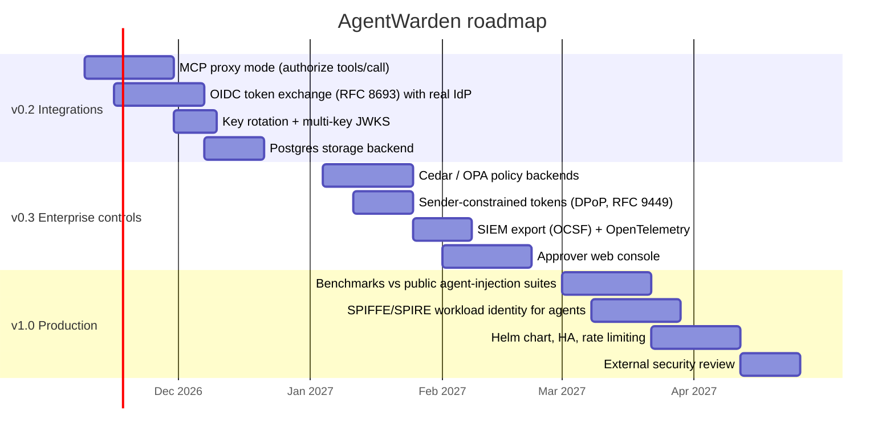

# AgentWarden: Project Plan

> **Identity & access management for AI agents.** AgentWarden is a policy enforcement point that sits
> between an AI agent and the tools it can call. It gives every agent a verifiable identity, issues it
> short-lived *delegated* credentials, and authorizes every tool call against deny-by-default policy,
> using a risk score that understands prompt injection.

| | |
|---|---|
| **Status** | v0.3.0 released (DPoP tokens, SIEM/OTel, public benchmark, action-provenance detector, Cedar/OPA backends); v0.2.0 added the MCP proxy, OIDC sign-in, key rotation, Postgres and the approver console |
| **Owner** | Mohammad Tawhid Mahmud |
| **Language / stack** | Python 3.11+, FastAPI, Pydantic v2, PyJWT (EdDSA/Ed25519), SQLite or PostgreSQL |
| **License** | MIT |

---

## 1. Problem statement

LLM agents are being wired to email, file systems, databases, payment APIs and other agents. The
identity and access patterns behind most of these integrations were designed for humans or for
deterministic services, and they break down for agents:

1. **Ambient, over-broad authority.** Agents usually run with a long-lived API key or a service
   account that can do everything any of its tools can do. This is *Excessive Agency*
   ([OWASP LLM06:2025](https://genai.owasp.org/llm-top-10/)).
2. **Confused-deputy attacks through prompt injection.** Untrusted content (a web page, an email, a
   retrieved document, a tool output) can carry instructions that the model follows with the
   agent's privileges ([OWASP LLM01:2025](https://genai.owasp.org/llm-top-10/)).
   A static permission check cannot tell a user-intended `send_email` from an injected one.
3. **No "who did this?" answer.** Audit logs record the service account, not the human the agent
   acted for, the agent that acted, or the chain of sub-agents in between.
4. **Unbounded delegation.** In multi-agent systems a sub-agent typically inherits all of its
   parent's credentials. Nothing attenuates privilege as work is delegated.
5. **Weak human-in-the-loop.** Approvals are often a UI prompt that is not bound to the exact
   action, can be replayed, and can be granted by the requester themselves.

## 2. Vision & goals

**Vision:** every action an AI agent takes is *attributable*, *least-privileged*, *contextually
authorized* and *verifiably audited*.

| # | Goal | Measured by |
|---|------|-------------|
| G1 | Give agents first-class, non-human identities separate from the users they act for | Tokens carry `sub` (user) + `act` (agent chain), per RFC 8693 |
| G2 | Enforce least privilege with attenuated, short-lived, delegated credentials | Granted scopes = requested ∩ user entitlements ∩ agent ceiling; TTL ≤ 1h |
| G3 | Authorize every tool call with deny-by-default, testable policy-as-code | 100% of calls evaluated; policy test suites run in CI |
| G4 | Make authorization *injection-aware* by scoring the provenance of a call's data | Attack corpus detection rate ≥ 90% with false-positive rate ≤ 10% |
| G5 | Bind human approvals to the exact action, single-use, with separation of duties | Approval reuse, argument tampering and self-approval are all rejected (tests) |
| G6 | Produce a tamper-evident audit trail and actionable least-privilege findings | Hash-chain verification detects any modified row; analyzer flags unused scopes |

### Non-goals (v0.x)

- Being a general-purpose IdP. AgentWarden integrates with one (OIDC token exchange, built in v0.2).
- Guaranteeing prompt-injection detection. Heuristics and LLM judges can be evaded. The design
  relies on **deterministic IAM controls** (scopes, policy, approvals) as the primary defense and
  uses risk scoring as an additional signal.
- Content moderation, model hosting, or agent orchestration.

## 3. Personas & primary use cases

| Persona | Needs | Key flows |
|---|---|---|
| **AI application developer** | Ship agents without hand-rolling authz | SDK `@guarded` decorator; local in-process mode; clear deny reasons |
| **Platform / security engineer** | Central control over what agents may do | Agent registry, scope ceilings, YAML policy, kill switch, revocation |
| **Approver (e.g. team lead)** | Review risky actions quickly and safely | Approval queue with risk evidence, bound to exact arguments |
| **Auditor / compliance** | Prove who did what, on whose behalf | Hash-chained log with signed checkpoints, least-privilege report |

## 4. Security design principles

1. **Deny by default.** Unknown agents, tools, scopes and unmatched requests are denied.
2. **Scopes are the ceiling, policy is the gate.** A token's scopes cap what is *possible*. Policy
   decides what is *appropriate in context*.
3. **Attenuate on every hop.** Delegation can only narrow scopes and shorten lifetimes.
4. **Treat untrusted data as tainted.** Data that came from tools, documents or the web is tracked as
   untrusted. When tainted values reach a sensitive sink, risk goes up.
5. **Deny overrides; approvals never grant.** `deny` beats everything, unmatched requests are denied, and `require_approval` only gates actions that an `allow` rule already permits.
6. **Bind and expire approvals.** Approvals are bound to a hash of the exact call, are single-use,
   expire, and can't be granted by the requester.
7. **Verifiable by default.** Every decision is logged in a hash chain, and secrets are redacted before storage.
8. **No algorithm agility at verification.** Only `EdDSA` is accepted, which removes `alg=none` and HS/RS confusion.

## 5. Scope (MoSCoW) for v0.1

| Priority | Capability | Status |
|---|---|---|
| Must | Agent registry with owner, trust tier, scope ceiling, enable/disable (kill switch) | ✅ |
| Must | Ed25519-signed delegated tokens (`sub` user, `act` agent), JWKS endpoint, revocation | ✅ |
| Must | Sub-agent delegation with scope attenuation, depth limit and `exp` clamping | ✅ |
| Must | Deny-by-default YAML policy engine (RBAC + ABAC conditions, `all`/`any`/`not`) | ✅ |
| Must | Risk engine: prompt-injection, taint-flow, secret-leak, exfiltration, behavior anomaly | ✅ |
| Must | Human-in-the-loop approvals (bound, single-use, expiring, separation of duties) | ✅ |
| Must | Hash-chained audit log + verification + signed checkpoints | ✅ |
| Must | REST API (FastAPI), Python SDK, CLI | ✅ |
| Should | Policy-as-code unit tests (`agentwarden policy test`) | ✅ |
| Should | Least-privilege analyzer (unused/wildcard scopes, dormant agents, deny-rate) | ✅ |
| Should | Detector evaluation harness with a labeled corpus (`agentwarden eval`) | ✅ |
| Should | Scripted end-to-end attack demo (`agentwarden demo`) | ✅ |
| Could | Optional LLM judge (Claude) for injection classification | ✅ (off by default) |
| Could | Docker image + compose | ✅ |
| Won't (v0.1) | MCP proxy mode, OIDC integration, Postgres, web dashboard | Planned (see roadmap) |

## 6. Architecture (summary)

```
 User ──(API key / OIDC*)──► Token exchange ──► delegated JWT (sub=user, act=agent, scope, task)
                                                        │
 Agent ──(JWT + tool call + untrusted context)──► AgentWarden Gateway
                                                        │
        1. Authenticate token (EdDSA, aud/iss/exp, revocation, agent chain enabled)
        2. Resolve tool (registry) and check required scope ⊆ token scopes
        3. Risk engine: detectors ──► noisy-OR risk score + evidence
        4. Policy engine: deny > default deny > require_approval > allow
        5. Approvals: bound to sha256(tool, args, user, agent), single-use
        6. Audit: hash-chained, redacted, signed checkpoints
                                                        │
                                       ALLOW / DENY / REQUIRE_APPROVAL
```

See [ARCHITECTURE.md](ARCHITECTURE.md) for component diagrams and sequence flows, and
[THREAT_MODEL.md](THREAT_MODEL.md) for the STRIDE and OWASP mapping. (*OIDC sign-in was added in v0.2.)

## 7. Delivery phases (v0.1 MVP)

| Phase | Deliverables | Acceptance criteria | Status |
|---|---|---|---|
| **P0: Foundations** | Repo, packaging, CI (lint, types, tests, SAST), project plan, threat model | CI green on 3.11–3.13; docs reviewed | ✅ |
| **P1: Agent identity** | Key manager + JWKS, token service, scope algebra, agent registry, revocation | Tokens verify; tampered, expired, revoked, `alg=none` and HS256 tokens rejected | ✅ |
| **P2: Policy engine** | Policy schema + validation, condition operators, combinators, precedence, policy tests | Default-deny proven; invalid policies fail to load with clear errors | ✅ |
| **P3: AI risk detection** | Injection (incl. Unicode tag smuggling, bidi, zero-width), taint-flow, secrets, exfil, anomaly; optional LLM judge; eval harness | Corpus recall ≥ 90%, FPR ≤ 10%; evidence attached to every signal | ✅ |
| **P4: Governance** | Approval queue with SoD, hash-chained audit + checkpoints, least-privilege analyzer | Tamper detection test passes; approval replay/tamper/self-approval rejected | ✅ |
| **P5: Interfaces** | FastAPI service, SDK (`WardenClient`, `LocalWarden`, `@guarded`), CLI, demo, Docker | End-to-end demo blocks the injected exfiltration and allows the legitimate flow | ✅ |

## 8. Roadmap (post-MVP)



### Backlog detail

| Version | Item | Why it matters |
|---|---|---|
| v0.2 ✅ | **MCP proxy mode**: a transparent proxy in front of MCP servers that authorizes every `tools/call` | MCP is becoming the default way agents reach tools, and it needs a central enforcement point. **Built:** `agentwarden mcp-proxy` |
| v0.2 ✅ | **OIDC token exchange**: accept an IdP-issued ID token as `subject_token` | Replaces demo API keys with real user identity. **Built:** `POST /v1/token/exchange` (RFC 8693) |
| v0.2 ✅ | **Key rotation**: key ring, `kid` selection, multi-key JWKS, grace periods | Limits blast radius of key compromise. **Built:** `agentwarden keys rotate/list/prune` and admin API |
| v0.2 ✅ | **Postgres backend** | Multi-instance deployments. **Built:** `AGENTWARDEN_DATABASE_URL`, shared state across instances, CI on Postgres 16 |
| v0.3 ✅ | **Cedar / OPA backends** | Lets organizations reuse existing policy investments. **Built:** `AGENTWARDEN_POLICY_BACKEND=cedar\|opa`, default policy ported to both, one test suite for all three ([POLICY_BACKENDS.md](POLICY_BACKENDS.md)) |
| v0.3 ✅ | **DPoP-bound tokens** | Stolen agent tokens become useless without the agent's private key. **Built:** RFC 9449 binding on issue, exchange and delegation; `agentwarden dpop keygen`; SDK and MCP proxy support |
| v0.3 ✅ | **OCSF/SIEM export, OTel traces** | SOC visibility, correlation with other telemetry. **Built:** `agentwarden audit export` (file/HTTPS, chain-checked cursor), `GET /v1/audit/export`, OTel spans and metrics ([SIEM.md](SIEM.md)) |
| v0.3 ✅ | **Approver console** | Better HITL ergonomics; reduces approval fatigue. **Built:** `/console` with full review evidence |
| v1.0 ✅ | **Benchmark harness** against public agent prompt-injection suites | Credible, comparable detection numbers. **Built:** `agentwarden bench` on InjecAgent and BIPIA, CI gates ([BENCHMARK.md](BENCHMARK.md)) |
| v1.0 | **SPIFFE workload identity** | Cryptographic agent identity without shared secrets |

## 9. Success metrics

| Metric | Target (v0.1) | Result (v0.1.0) | How it's measured |
|---|---|---|---|
| Test coverage | ≥ 85% lines | ✅ **95%** (346 tests on SQLite and PostgreSQL) | `pytest --cov`, CI floor 90% |
| Authorization latency (in-process, heuristics only) | p95 < 5 ms | ✅ **0.95 ms** clean call · **3.6 ms** with 2.5 KB of context | 500-call micro-benchmark incl. token verification and audit write |
| Injection corpus recall / FPR | ≥ 90% / ≤ 10% | ✅ **95.2% / 8.7%** (precision 90.9%) | `agentwarden eval` on the bundled corpus, CI gate |
| Static analysis | 0 high-severity findings | ✅ 0 findings | `bandit`, `ruff` security rules, Trojan Source scan |
| Policy regressions | 0 failing policy cases | ✅ 28/28 | `agentwarden policy test` in CI |

| Public benchmark (InjecAgent, full gateway) | attack success ≤ 3%, utility ≥ 99% | ✅ **0.8%** all · **1.7%** held-out (0% data stealing) / **100%** | `agentwarden bench`, CI gate |
| Benign user actions after reading documents | false alarms ≤ 5% | ✅ **1.9%** | `agentwarden bench`, CI gate |
| Public benchmark (BIPIA documents) | false positives ≤ 2% | ✅ **0.5%** (detector recall 59.0% overall) | `agentwarden bench`, CI gate |

> The bundled corpus is small and hand-written. It works as a **regression suite**, not as a
> benchmark. [BENCHMARK.md](BENCHMARK.md) has the public-dataset method, results and limitations.

## 10. Testing & evaluation strategy

- **Unit tests** for each component: scopes, tokens, policy operators, detectors, approvals, audit, analyzer.
- **Adversarial tests**: `alg=none`/HS256 confusion, signature tampering, expired/revoked tokens,
  delegation escalation, approval replay and argument tampering, self-approval, audit row tampering,
  Unicode smuggling, homoglyph/full-width obfuscation.
- **Integration tests** through the FastAPI app and the SDK (`TestClient`).
- **Policy-as-code tests**: YAML cases asserting decisions for the default policy, run in CI.
- **Detector evaluation**: precision/recall/FPR over a labeled corpus, with a CI gate.

## 11. Risks & mitigations

| Risk | Impact | Mitigation |
|---|---|---|
| Detector evasion (novel injection phrasing) | Injected call scores low | Deterministic controls stay primary (scope ceiling, recipient/domain policy, approvals); taint-flow is phrasing-independent; optional LLM judge |
| False positives annoy users | Users bypass the tool | Default policy uses `require_approval` for medium risk and reserves `deny` for high-confidence cases; evidence explains each decision |
| Signing key compromise | Forged tokens | Short TTLs, `kid`, key files outside the repo, zero-downtime rotation and pruning (built); DPoP (built) limits theft of individual tokens |
| Approval fatigue | Rubber-stamping | Risk evidence in queue, only high-impact actions gated, analyzer reports approval volume |
| SQLite limits | Single-node only | Resolved: PostgreSQL backend for several instances (v0.2) |
| LLM judge leaks sensitive context to a third party | Data exposure | Off by default, explicit opt-in, documented data flow, results cached by content hash |

## 12. Lessons from building v0.1

Building the demo and examples end to end surfaced real issues that unit tests alone missed:

1. **Serialization can launder attacks.** The SDK JSON-encoded tool outputs with
   `ensure_ascii=True`, which turned smuggled Unicode tag characters into harmless-looking
   `\uXXXX` text before the detectors saw it. The fix (`ensure_ascii=False`) has a regression test.
2. **Hard denies need call-level evidence.** A request the user explicitly made was denied only
   because the agent's context was poisoned. Context-only evidence is now capped so it escalates to
   approval, and denies require a tainted destination, secrets or injected arguments.
3. **Security tooling must protect its own repository.** Writing detectors for invisible
   characters accidentally placed literal invisible characters in the source. A CI scan now blocks
   them (Trojan Source).
4. **Flaky security tests hide regressions.** A tamper test that was a no-op 1 time in 16 was caught
   by CI and made deterministic.

## 13. Definition of done (per feature)

- Code + type hints + docstrings, `ruff` and `mypy --strict` clean
- Unit tests including at least one adversarial case
- Documentation updated (README / reference docs)
- Audit events emitted for any security-relevant state change
- CI green
